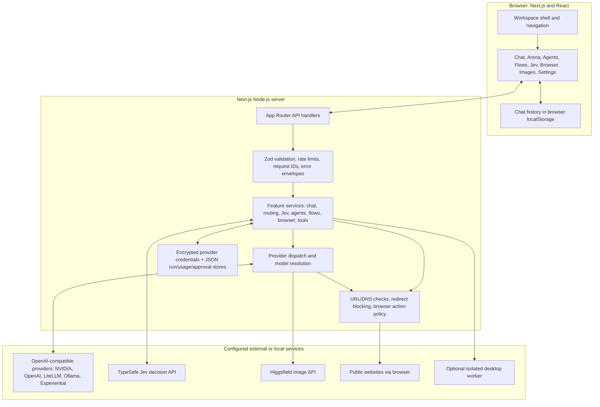
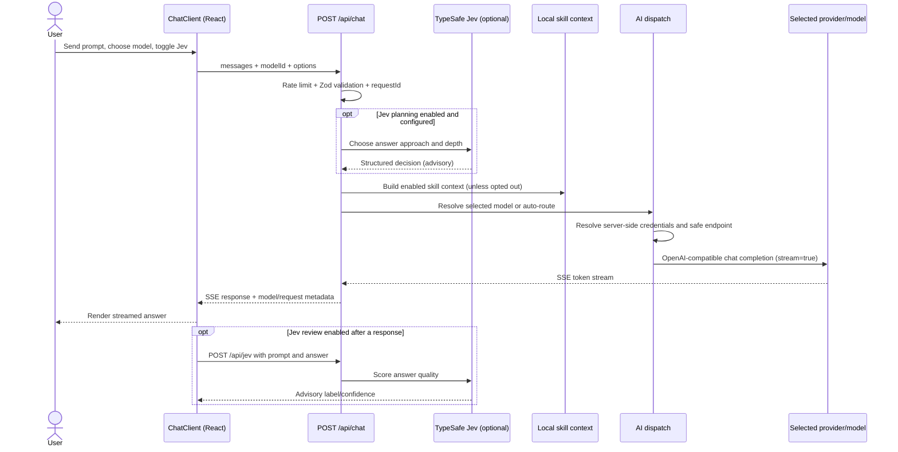

# ScaleOS AI: Architecture and Interview Guide

This guide describes the implementation in this repository today. It separates shipped behavior from planned production work so you can explain the system accurately in an interview.

## 1. The short explanation

ScaleOS AI is a local-first AI workspace built with Next.js App Router, React, and TypeScript. The browser UI calls server-side route handlers; those handlers validate requests, choose or resolve a model, and dispatch through a shared OpenAI-compatible provider layer. Feature services add orchestration such as Jev planning, bounded agents, browser automation, or image jobs. Credentials stay server-side, and the current persistence layer is localStorage plus file-backed JSON rather than a production database.

## 2. System architecture



### Architectural layers

| Layer | What it does | Main locations |
|---|---|---|
| App/UI | Pages, workspace shell, forms, chat state, rendering | `app/`, `components/` |
| API boundary | HTTP methods, request validation, rate limiting, request IDs, response shaping | `app/api/`, `lib/api/` |
| Domain services | Model routing, Jev decisions, browser policy, agents, flows, skills, tools | `lib/ai/`, `lib/computer/`, `lib/agents/`, `lib/flows/`, `lib/skills/`, `lib/tools/` |
| Provider/security | Provider resolution, safe server-side HTTP, credential encryption, approval tokens | `lib/security/`, `lib/permissions/`, `lib/ai/dispatch.ts` |
| Persistence | Browser conversation history and local server JSON collections | `lib/chat/`, `lib/store/`, `lib/runs/`, `lib/usage/` |

## 3. Chat request: from prompt to streamed answer



### What actually happens

1. `components/chat-client.tsx` sends conversation messages and an optional model ID to `/api/chat`.
2. The route checks a per-client in-memory rate limit and validates the body with Zod.
3. If Jev planning is enabled and configured, `lib/ai/chat-planner.ts` asks Jev for a response style/depth. It is advisory: failure does not block the model answer.
4. The route can add local skill descriptions as system context. The skill files are scanned locally; when included, that context is sent with the prompt to the chosen model provider.
5. `lib/ai/dispatch.ts` resolves `<provider>:<model-id>`, obtains the credential on the server, checks the provider URL, and makes an OpenAI-compatible request.
6. The API returns a server-sent event stream. The React client accumulates tokens and renders Markdown.
7. Jev's review is a separate post-answer decision call. It does not rewrite the answer.

## 4. Browser task: prompt-driven web research with controls

```mermaid
sequenceDiagram
  actor User
  participant UI as ChatClient: Browser task mode
  participant API as /api/computer/browser/run
  participant Agent as Browser agent
  participant Model as Selected LLM
  participant Browser as CDP browser
  participant Policy as URL/action policy

  User->>UI: Ask to search, compare, or read public pages
  UI->>API: objective + modelId + action budget
  API->>API: Zod validation + rate limit
  API->>Agent: Run objective with request cancellation signal
  Agent->>Browser: Attach to configured CDP or launch disposable dev browser
  loop Until done, stopped, or action budget exhausted
    Agent->>Browser: Read page snapshot and semantic element references
    Agent->>Model: Request next bounded JSON action plan
    Model-->>Agent: navigate/click/fill/scroll/extract/done
    Agent->>Policy: Check destination and proposed interaction
    Policy-->>Agent: Allow, block, or require approval
    Agent->>Browser: Execute permitted action and refresh snapshot
  end
  User->>UI: Stop browser task
  UI->>API: Abort the in-flight request
  API->>Agent: Abort provider request and CDP session
  Agent-->>API: Cancelled result; completed actions are not undone
  API-->>UI: Cancelled status
```

The model proposes actions; it does not get raw shell access. The agent parses actions against a Zod schema, checks public URL safety and policy, then drives a browser through Chrome DevTools Protocol. Local development can launch a fresh temporary headless Chrome/Edge profile. Production requires an explicitly configured browser endpoint. The browser task is designed for public research and navigation. It does not solve CAPTCHAs or bypass paywalls, and sensitive actions may be blocked or sent to approval.

The Stop button aborts the request, propagates cancellation to the provider call, interrupts the CDP connection, and closes the temporary browser. It cannot reverse a side effect that completed before the stop.

## 5. Other feature paths

- **Model Arena (`/arena`)**: sends one prompt to 2–4 selected models concurrently with `Promise.allSettled`, reports partial failures, and can ask Jev to judge model answers.
- **Agents (`/agents`)**: bounded planner → executor steps → synthesizer. The current runtime explicitly has no external tools, so it must not claim it browsed or performed actions.
- **Flows (`/flows`)**: server-side Input → Prompt → Model → Output steps, with intermediate outputs and a final result. The engine stops at the first failure.
- **Tools (`/api/tools`)**: fixed allowlist such as calculator, datetime, text statistics, and safe web fetch; no arbitrary code execution.
- **Images (`/image`)**: submits an asynchronous Higgsfield job and polls its job status route.
- **Computer Use (`/computer`)**: delegates desktop work to an optional isolated worker service. It is separate from the browser task's CDP browser.
- **Voice (`/voice`)**: voice-intent/controller routes provide command-oriented interaction; this is distinct from chat's text-generation pipeline.
- **Skills (`/skills`)**: reads local skill metadata and provides enabled context to chat. It does not upload the scanned skill directory automatically.

## 6. Model and provider design

`lib/ai/providers.ts` describes provider endpoints and environment variables. `lib/ai/registry.ts` describes models and their capabilities. `lib/ai/routing.ts` chooses among enabled models that satisfy requested capabilities. `lib/ai/dispatch.ts` resolves a target and performs the actual request.

In chat, an explicit model ID takes priority. Without one, the chat route has a deterministic priority list; it checks configured providers and, for Ollama, checks installed models. Other services may use `chooseModel` with capability and preference filters. Compatible model IDs can also be addressed as `provider:model-id`. The registry is metadata; it is not proof that an external provider is reachable at this moment, so provider test/status endpoints and honest runtime errors matter.

Provider keys saved through Settings are encrypted with AES-256-GCM in a local JSON file using `CREDENTIAL_ENCRYPTION_KEY`. Saved credentials take precedence over environment variables. APIs return masked metadata, not plaintext keys. Provider calls are server-side. URL validation checks schemes, embedded credentials, DNS/private addresses, and redirects to reduce SSRF risk.

## 7. Data and trust boundaries

```mermaid
flowchart LR
  ChatUI[Chat UI] -->|conversation messages| LocalStorage[(Browser localStorage)]
  SettingsUI[Provider settings UI] -->|key over HTTPS/local app request| ProviderAPI[Provider API]
  ProviderAPI -->|AES-256-GCM ciphertext| CredentialFile[(data/providers.json)]
  ProviderAPI -->|masked credential only| SettingsUI
  ApiRoutes[Run/API routes] --> JsonStore[JSON store boundary]
  JsonStore --> RunFile[(runs.json)]
  JsonStore --> UsageFile[(usage-events.json)]
  JsonStore --> ApprovalFile[(approvals.json)]
  ApiRoutes -->|validated prompts| Provider[External model service]
  BrowserAgent[Browser agent] -->|public HTTP(S), checked destination| Web[Web pages]
  Web -->|untrusted page text and labels| BrowserAgent
```

| Data | Current storage | Interview-accurate caveat |
|---|---|---|
| Chat history | Browser `localStorage` | Per browser/device; not synchronized between users/devices |
| Provider keys | Encrypted local `data/providers.json`, or environment variables | Encryption depends on a separately protected master key |
| Runs, usage, approvals | File-backed JSON collections under `SCALEOS_DATA_DIR` | Single-host local storage; not a concurrent multi-node database |
| Models and provider definitions | TypeScript registry/provider definitions plus live config status | Some compatible IDs are passed through dynamically |
| Skills | Local filesystem scan | Skill descriptions/context can be sent to a model when enabled |

Untrusted input includes prompts, model output, and webpage contents. Request schemas constrain external input; model-generated browser actions are parsed and policy-checked; model text is not executed as code. Approval tokens are HMAC-signed, expire, and are single-use.

## 8. Repository map

```text
app/                    Next.js pages and route handlers
  api/                  HTTP boundary for chat, providers, runs, browser, etc.
components/             React workspace UI and feature clients
lib/ai/                 Provider catalog, model registry, routing, dispatch, Jev
lib/computer/           CDP driver, browser agent, policy, local browser launcher
lib/agents/             Bounded agent runtime and supporting tools
lib/flows/              Workflow execution engine
lib/security/           Encrypted credential storage, safe URLs/fetch, rate limit
lib/permissions/        Signed single-use approval checkpoint kernel
lib/store/              File-backed JSON collection abstraction
lib/runs/, lib/usage/   Run history and usage summaries
lib/chat/               Browser-side conversation storage and retry helpers
lib/skills/             Local skill scanning and chat-context building
tests/                  Vitest unit/contract tests
docs/                   Architecture and feature design notes
```

## 9. What is implemented vs. planned

**Implemented now:** Next.js App Router, typed TypeScript modules, Zod request contracts, model/provider registry, OpenAI-compatible server dispatch, streaming chat, optional Jev planning/review, local browser task runtime, encrypted local provider-key storage, file-backed usage/run/approval data, and unit/contract tests.

**Not yet production-complete:** full user authentication and workspace tenancy, PostgreSQL persistence, distributed rate limiting, durable background job orchestration, multi-instance shared cancellation/run state, a dedicated Anthropic adapter, and production browser-worker provisioning. Do not describe the future PostgreSQL/auth shape in `docs/architecture.md` as already deployed.

## 10. A 60-second interview answer

> “ScaleOS is a local-first, provider-agnostic AI workspace built with Next.js App Router, React, and TypeScript. The UI calls typed API routes. Those routes validate with Zod, apply rate limits, resolve a selected or capability-compatible model, and use one server-side dispatch layer for OpenAI-compatible providers. Credentials are encrypted at rest and never returned to the client. Chat streams responses over SSE; Jev can optionally steer the answer before generation and score it afterward. Separate feature services handle bounded agents, model comparisons, flows, and policy-checked browser automation. The current app uses localStorage and file-backed JSON, so authentication, multi-tenant persistence, distributed jobs, and production scaling are clear next steps rather than claims I’d make about the current build.”

## 11. Interview questions to rehearse

### How do you add a provider?

Add provider metadata and environment/auth handling, add or sync model metadata/capabilities, ensure the provider's URL is validated, and keep the request behind `lib/ai/dispatch.ts`. Then test connection, generation, error mapping, and secret masking. A provider should not require each feature page to implement its own HTTP/auth logic.

### How does a prompt select a model?

An explicitly selected model is resolved directly. Auto mode filters to configured models and uses deterministic priorities or capability-based `chooseModel`, depending on the route. A target contains provider ID, external model ID, and a display name; dispatch uses the provider ID to obtain the server-side endpoint and credential.

### What does Jev do?

Jev is a decision API rather than the generator. When enabled, it chooses an approach/depth before the LLM answers; it can also judge the final answer afterward. It is advisory and does not replace the selected LLM, execute browser actions, or make provider output trustworthy by itself.

### How do you prevent prompt injection in browser tasks?

Treat page text as untrusted, ask the selected model for a bounded JSON action plan, validate it against an action schema, re-check URLs and action risk in deterministic code, and require approval or block consequential interactions. Do not execute arbitrary model-produced code. Keep each iteration observable and limit the action budget.

### How are secrets protected?

Credentials remain on the server. UI-entered provider keys are encrypted with AES-256-GCM before local persistence, masked on reads, and never included in model prompts or responses. The encryption key itself must be protected through deployment secret management. Hosted credential mutation also has an admin-token boundary while full auth is pending.

### What would you improve before production?

First add authentication and workspace-level authorization, then move credentials and operational records into a transactional shared database. Replace in-memory rate limits with a distributed limiter; put long-running browser/image/agent work in a job queue with durable status and cancellation; add structured logs, tracing, provider health/circuit breakers, retention policies, and concurrency tests. Keep the provider and storage interfaces so those changes do not leak into UI components.

### What trade-off did you choose?

The current design favors a clear vertical slice and a narrow provider contract over introducing a large agent framework. Direct HTTP dispatch is easy to inspect and debug, but provider-specific features and complex job lifecycles may eventually need dedicated adapters and workers. Local JSON is useful for a single-machine prototype, but it is not a production multi-user datastore.

## 12. Where to read the implementation

- Chat endpoint: `app/api/chat/route.ts`
- Provider dispatch: `lib/ai/dispatch.ts`
- Routing: `lib/ai/routing.ts`
- Provider definitions and model registry: `lib/ai/providers.ts`, `lib/ai/registry.ts`
- Jev decision integration: `lib/ai/jev.ts`, `lib/ai/chat-planner.ts`, `lib/ai/chat-judge.ts`
- Browser run endpoint and agent: `app/api/computer/browser/run/route.ts`, `lib/computer/browser-agent.ts`
- Browser driver and policy: `lib/computer/cdp.ts`, `lib/computer/policy.ts`
- Credential crypto/store and safe fetch: `lib/security/crypto.ts`, `lib/security/store.ts`, `lib/security/fetch.ts`
- Local JSON and durable run records: `lib/store/json-store.ts`, `lib/runs/store.ts`, `lib/usage/meter.ts`
